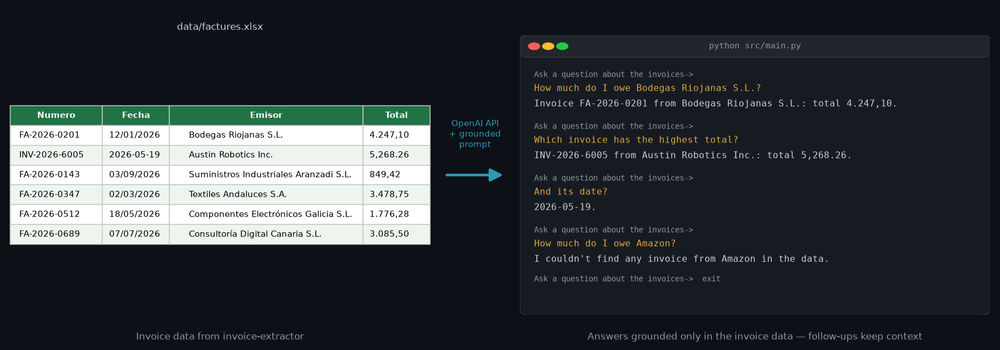
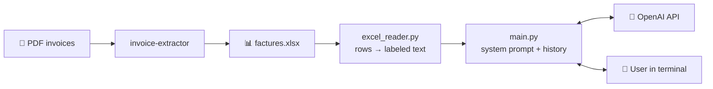

# 💬 Invoice Chatbot

*[Leer en español](README_es.md)*


**Ask your invoices questions in plain language — and get answers grounded only in your data.**

A terminal assistant built on the OpenAI API that answers natural-language questions about invoice data: *"How much do I owe Bodegas Riojanas?"*, *"What was the most expensive invoice in March?"*, *"And its date?"*. It reads the structured Excel produced by [invoice-extractor](https://github.com/K4iserDev/invoice-extractor), so the two projects form a complete pipeline: **PDF → Excel → conversation**.



---

## ✨ What it does

| Step | How |
|---|---|
| **1 · Load data** | Reads `data/factures.xlsx` and turns each row into an explicitly labeled line: `Número: … \| Fecha: … \| Emisor: … \| Total: … \| Formato: …` |
| **2 · Ground the model** | Builds a system prompt where that data is the **only source of truth**, with instructions not to invent anything and to copy cited values exactly |
| **3 · Chat** | Terminal loop with conversation memory, so follow-ups like *"and its date?"* work. Type `exit` or `salir` to quit |



## 🚀 Quick start

```bash
git clone https://github.com/K4iserDev/Invoice-Chatbot.git
cd Invoice-Chatbot

python -m venv .venv
.venv\Scripts\Activate.ps1          # Windows PowerShell
# source .venv/bin/activate         # macOS / Linux

pip install -r requirements.txt
```

Copy `.env.example` to `.env` and add your OpenAI API key:

```
OPENAI_API_KEY=sk-...
```

Then run it from the project root:

```bash
python src/main.py
```

A sample `data/factures.xlsx` with 59 invoices is included, so it works out of the box.

## 🗂️ Project structure

```
Invoice-Chatbot/
├── data/
│   └── factures.xlsx     # invoice table (output of invoice-extractor)
├── docs/                 # images for this README
├── src/
│   ├── config.py         # paths + loads the API key from .env
│   ├── excel_reader.py   # Excel rows → labeled text context
│   └── main.py           # system prompt, API calls, chat loop
├── .env.example
└── requirements.txt
```

## 🧠 Design decisions

- **Explicit labels on every value.** Early versions let the model swap values between fields. The root cause was a column-order mismatch in the data, not the prompt — fixed upstream, and every value is now labeled so the model can't mix them up.
- **Grounded, not creative.** The system prompt makes the invoice data the only allowed source and tells the model to say so when it can't find something, instead of guessing.
- **Conversation memory** with `system` / `user` / `assistant` roles, so the assistant understands follow-up questions.
- **API key outside the code**, loaded from `.env` with `python-dotenv` (and `.env` is git-ignored).

## ⚠️ Known limitations

- Reads an already generated Excel: PDF extraction lives in [invoice-extractor](https://github.com/K4iserDev/invoice-extractor).
- Column order is fixed to invoice-extractor's output (`Fecha, Formato, Emisor, Total, Numero`); a different order would give wrong answers.
- The whole table is sent on every request. Fine for dozens of invoices, not for thousands — that is what phase 2 solves.
- The model (`gpt-5-mini`) is hardcoded.

## 🛣️ Roadmap

- [ ] **Phase 2 — real RAG:** embeddings + a vector database over the full text of the original PDFs, for open questions beyond the 5 structured fields
- [ ] Model configurable from `.env`
- [ ] Validation step that checks every cited value against the source line
- [ ] Simple web interface (Streamlit or Gradio)

---

**Author:** Asier Martin · [GitHub](https://github.com/K4iserDev) · [LinkedIn](https://www.linkedin.com/in/asier-martin01)
