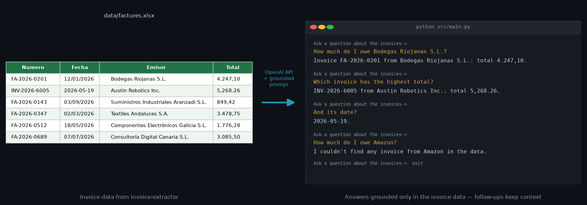
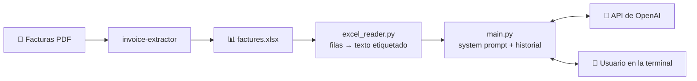

# 💬 Invoice Chatbot

*[Read in English](README.md)*


**Pregunta a tus facturas en lenguaje natural y obtén respuestas basadas solo en tus datos.**

Asistente de terminal construido sobre la API de OpenAI que responde preguntas sobre datos de facturas: *"¿Cuánto le debo a Bodegas Riojanas?"*, *"¿Cuál fue la factura más cara de marzo?"*, *"¿Y su fecha?"*. Lee el Excel estructurado que genera [invoice-extractor](https://github.com/K4iserDev/invoice-extractor), así que los dos proyectos forman un pipeline completo: **PDF → Excel → conversación**.



---

## ✨ Qué hace

| Paso | Cómo |
|---|---|
| **1 · Cargar datos** | Lee `data/factures.xlsx` y convierte cada fila en una línea con etiquetas explícitas: `Número: … \| Fecha: … \| Emisor: … \| Total: … \| Formato: …` |
| **2 · Anclar el modelo** | Construye un system prompt en el que esos datos son la **única fuente de verdad**, con instrucciones de no inventar nada y de copiar los valores tal cual |
| **3 · Conversar** | Bucle en la terminal con memoria de la conversación, para que funcionen preguntas de seguimiento como *"¿y su fecha?"*. Escribe `exit` o `salir` para terminar |



## 🚀 Puesta en marcha

```bash
git clone https://github.com/K4iserDev/Invoice-Chatbot.git
cd Invoice-Chatbot

python -m venv .venv
.venv\Scripts\Activate.ps1          # Windows PowerShell
# source .venv/bin/activate         # macOS / Linux

pip install -r requirements.txt
```

Copia `.env.example` como `.env` y añade tu clave de la API de OpenAI:

```
OPENAI_API_KEY=sk-...
```

Después ejecútalo desde la raíz del proyecto:

```bash
python src/main.py
```

Incluye un `data/factures.xlsx` de ejemplo con 59 facturas, así que funciona sin preparar nada más.

## 🗂️ Estructura del proyecto

```
Invoice-Chatbot/
├── data/
│   └── factures.xlsx     # tabla de facturas (salida de invoice-extractor)
├── docs/                 # imágenes de este README
├── src/
│   ├── config.py         # rutas + carga de la clave desde .env
│   ├── excel_reader.py   # filas del Excel → contexto de texto etiquetado
│   └── main.py           # system prompt, llamadas a la API y bucle de chat
├── .env.example
└── requirements.txt
```

## 🧠 Decisiones de diseño

- **Etiqueta explícita en cada valor.** En las primeras versiones el modelo intercambiaba valores entre campos. La causa real era un desajuste en el orden de las columnas de los datos, no el prompt: se corrigió en origen y ahora cada valor va etiquetado para que el modelo no los mezcle.
- **Anclado a los datos, no creativo.** El system prompt hace de los datos de facturas la única fuente permitida y le pide al modelo que avise cuando no encuentre algo, en vez de suponer.
- **Memoria de la conversación** con los roles `system` / `user` / `assistant`, para que entienda las preguntas de seguimiento.
- **La clave de la API fuera del código**, cargada desde `.env` con `python-dotenv` (y `.env` está en el `.gitignore`).

## ⚠️ Limitaciones conocidas

- Lee un Excel ya generado: la extracción de los PDF está en [invoice-extractor](https://github.com/K4iserDev/invoice-extractor).
- El orden de las columnas está fijado al de invoice-extractor (`Fecha, Formato, Emisor, Total, Numero`); con otro orden daría respuestas incorrectas.
- Se envía la tabla completa en cada petición. Vale para decenas de facturas, no para miles: eso lo resuelve la fase 2.
- El modelo (`gpt-5-mini`) está fijado en el código.

## 🛣️ Próximos pasos

- [ ] **Fase 2 — RAG de verdad:** embeddings + base de datos vectorial sobre el texto completo de los PDF originales, para preguntas abiertas más allá de los 5 campos estructurados
- [ ] Modelo configurable desde `.env`
- [ ] Paso de validación que compruebe cada valor citado contra su línea de origen
- [ ] Interfaz web sencilla (Streamlit o Gradio)

---

**Autor:** Asier Martin · [GitHub](https://github.com/K4iserDev) · [LinkedIn](https://www.linkedin.com/in/asier-martin01)
